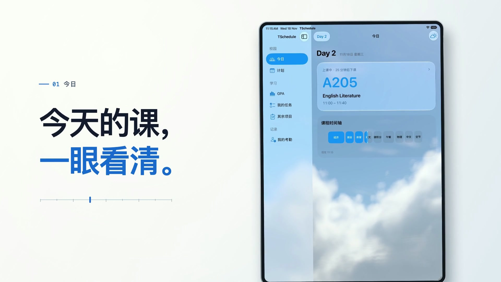
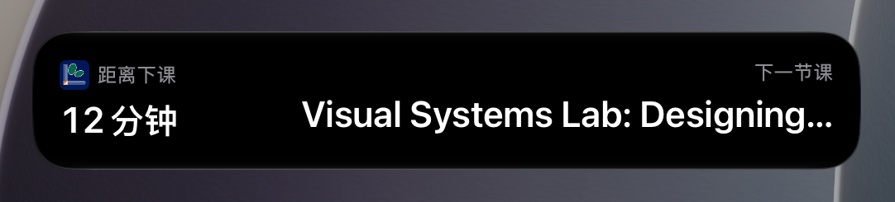

<p align="center">
  <picture>
    <source media="(prefers-color-scheme: dark)" srcset="Xiaobao-iPadOS/Resources/Assets.xcassets/TScheduleMark.imageset/tschedule-mark.png">
    
  </picture>
</p>

<h1 align="center">TSchedule · 澜图</h1>

<p align="center">
  为清澜山学生设计的 iPad 课表与计划工具。<br>
  <sub>iPadOS 26+ · SwiftUI · Metal · 0.3 开发版</sub>
</p>

<p align="center">
  <a href="#快速开始">快速开始</a> ·
  <a href="docs/tschedule-promo/Meet-TSchedule.mp4?raw=1">观看 75 秒宣传片 · 转屏版</a> ·
  <a href="docs/tschedule-app-store/02-artwork/ipad-13-inch/README.md">浏览界面截图</a>
</p>

[](docs/tschedule-promo/Meet-TSchedule.mp4?raw=1)

## 在 iPad 上

- **[今日](docs/tschedule-app-store/02-artwork/ipad-13-inch/01-today.png)** — 上课时看教室和下课倒计时；放学后或休息日，看下一个上课日的日期、轮转 Day 和已确认的首节课，点一下就到那天的计划。沿时间轴拖到下午，可以提前看下一节；天空的光线也跟着所选时刻变化。
- **[计划](docs/tschedule-app-store/02-artwork/ipad-13-inch/02-planner.png)** — 竖屏看一天，宽屏看一周。把自己的安排放在学校课表旁，拖到合适的时段，或按星期、按学校轮转 Day 重复。轮转计划只排在校历确认的教学日。移动个人计划不会改动学校课程。
- **[任务](docs/tschedule-app-store/02-artwork/ipad-13-inch/03-assignments.png)与[成绩](docs/tschedule-app-store/02-artwork/ipad-13-inch/04-gpa.png)** — 用学期下拉切换学校提供的记录，按课程和截止日期找作业，从课程总评点进每项考核。未公布的成绩不算作零分；个人试算也不会改写已公布成绩。
- **[考勤](docs/tschedule-app-store/02-artwork/ipad-13-inch/05-attendance.png)** — 按课堂、日常或活动查看考勤，也可以点进一门课，核对具体记录。

上课时还可以从「今日」开启**锁屏课表**。不用解锁 iPad，就能看见离下课还有几分钟、接下来上哪门课。

<p align="center">
  
  <br><sub>iPadOS 实时活动。配图不含真实学生记录。</sub>
</p>

## 快速开始

准备一台装有 **Xcode 26 或更高版本**的 Mac。查看校园资料需要清澜山学生校宝账号，无需另行启动服务器。

1. 下载或克隆**完整仓库**，从仓库根目录打开 App 工程：

   ```sh
   open Xiaobao-iPadOS/Xiaobao.xcodeproj
   ```

2. 在 Xcode 选择 **Xiaobao** Scheme 和一台 **iPadOS 26 或更高版本**的 iPad 模拟器，按 **⌘R** 运行。
3. 点「完整校宝」，在学校页面登录后点「完成」，即可在「今日」和「计划」查看本机保存的学年课表。需要在自己的设备上运行时，参见 [iPad 工程说明](Xiaobao-iPadOS/README.md)。

## 数据来源与隐私

课表、任务、考勤、考试、测评和分享的资料目录来自当前登录的校宝账号。任务可带已公布的单项分数；当前学期的成绩总览在进入 GPA，或有有效会话且已显示本机「今日」时按需读取；历史学期仅按选择加载。缺少依据的课程和成绩不填充；作业提交仍在学校网页完成。

首次登录会把可确认的六日轮转课表保存到本机。「今日」与「计划」共用；翻周、断网或重开不重抓课表，手动更新在「设置 → 更新课表」。确认退出或换号清除旧课表。「我的任务」在前台核对所选学期，保存最近一次完整的作业清单和时间；断网重开仍可看，无法确认不当作零项。清单受系统文件保护、不参与备份，不保存分数、答案或附件。成绩和考勤仍仅在会话内；校务资料不经开发者服务器中转。若主动开启锁屏课表，iPadOS 会在锁屏上显示课程摘要。详见[设备内读取说明](Xiaobao-iPadOS/Sources/Native/SchoolPortalSync/README.md)与[可选的本机代登录](Xiaobao-iPadOS/Sources/Native/SchoolPortalLogin/README.md)。

TSchedule 是独立学生项目，并非学校或校宝的官方客户端。界面与读取流程通过隔离测试；学校实际提供的资料以本人账号为准。

在「设置 → 隐私」可离线阅读[隐私政策与使用条款（中英讨论稿）](docs/tschedule-app-store/04-web/README.md)。

课程提醒默认关闭：在「设置 → 提醒」可选择上课时或提前通知。提醒根据本机已确认的课表安排，不显示课程名或教室。作业截止提醒也默认关闭：只为本学期明确待交且有准确截止时间的作业提前一小时提醒，标题默认隐藏。改期、提交或撤回要在下次完整同步后才会反映到通知。个人计划仍可单独设置提醒。

## 开发

| 入口 | 内容 |
| --- | --- |
| [iPadOS 客户端](Xiaobao-iPadOS/README.md) | SwiftUI 界面、Metal 天空、核心逻辑与构建指南。 |
| [模块索引](MODULE_INDEX.md) | 按职责查找源码入口与模块文档。 |

许可证：[MIT](LICENSE)。

在仓库根目录运行对应测试：

```sh
swift test --package-path Xiaobao-iPadOS
cargo test --locked --manifest-path xiaobao-backend/Cargo.toml
```

## 致谢

感谢清澜山学校。特别感谢 [Peter Li 学长（@Haoxuan1016）](https://github.com/Haoxuan1016)、[Lanbin07（@lanbinshijie）](https://github.com/lanbinshijie) 和 [Leo Huo（@lanbinleo）](https://github.com/lanbinleo)。

## 联系

维护者邮箱：[steven.xie.28.tsinglan.org@gmail.com](mailto:steven.xie.28.tsinglan.org@gmail.com)。反馈问题时，请附上 iPadOS 版本和复现步骤；请勿发送学校账号密码、Cookie 或含个人成绩的截图。
