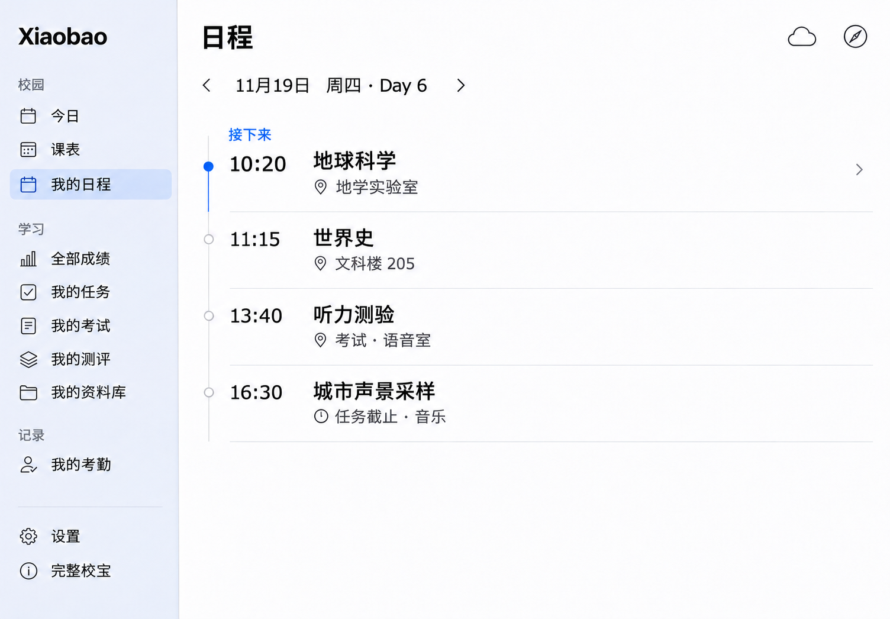
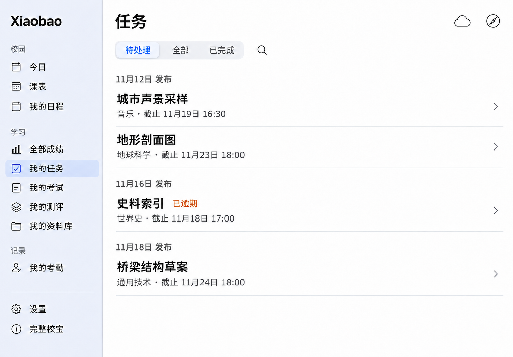
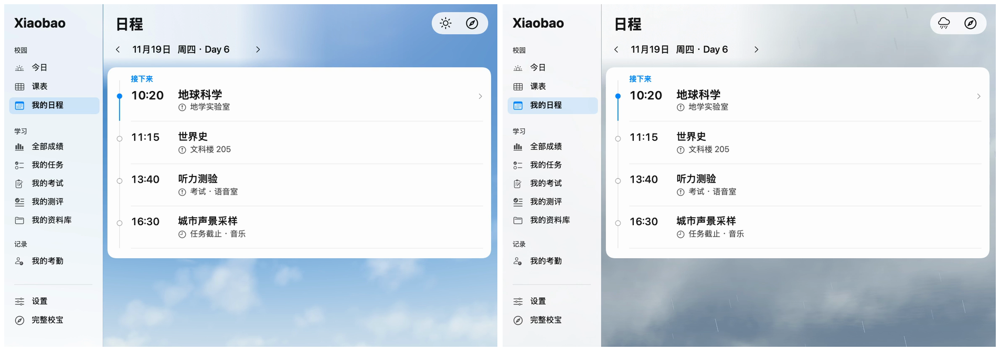

# 校宝 iPadOS · 学生端界面改版讨论稿

**当前日程导航（2026-11-20）：** 独立「课表」已由「计划」接替，校园区只保留「今日」和「计划」。各主页面的顶栏日期按钮显示当天的轮转 Day 或实际日期，直接进入「计划」当天。下文关于保留独立周表和限制顶栏 Day 的说明是旧版讨论记录，校历资料和原讨论保留供追溯。

**2026-11-19 · 四页重点已确认：日程先看下一项，任务按发布时间排，成绩直达 GPA，考勤先看个人出勤率和各状态占比。** 日程和任务保留 R1 的排版方向，但所有业务页都应看得见随天气变化的动态天空。R2 展示这个条件如何落在日程上，未修改 App。其他页面只讨论与这四页的关系，不推断它们已经通过审查。

## 先定方向

**首屏先给学生来这一页要看的结果。** 任务页的计数不能挡在作业前面；考勤页恰好相反，个人出勤率和各类记录的比例就是结果。先把这些数字放在一起，想知道具体哪门课再往下查。

建议这一轮**保留侧栏和原栏目，先重做「日程」和「任务」的首屏**，用这两页确定标题、筛选、列表和背景的关系，再将同一规则用于成绩和考勤。不要一边换视觉、一边改所有入口，否则很难判断哪个改动让页面更好用。

## 首轮横屏草图 · R1（保留排版方向）

两张图是同一套排版的两个页面，不是二选一。课程、地点和任务均为虚构样例；情境时钟固定在 11 月 19 日 10:10，仅用于辨别下一项和已逾期。草图用内置 ImageGen 生成，不是 App 截图。正文用浅底便于检查阅读顺序，不代表移除动态天气。

**日程：把地点放回下一项旁边。** 对照原图 1，日期收成一行。视线落在时间线本身：10:20 的地球科学，地点就在课名下方，不用再扫到另一侧。最后一行是任务截止，用时钟而不是地点图标。

**任务：让发布和截止各司其职。** 对照原图 3，三栏计数不再抢在第一项前面。发布日期是灰色分组标题；每项自己的截止时间紧跟科目。第三项已逾期，但仍留在它的发布日期下。

这轮只看横屏首屏的排版。滚动回看、详情返回、窄窗和大字号仍需用可操作的原型验证；图中能标发布日期，也不代表现有数据已含这个字段。

## 日程天气对照 · R2

[播放 8 秒动态对照](wireframes/agenda-weather-r2.mp4)：前 4 秒晴，后 4 秒中雨，中间直接切换以便比较。固定同一日期、同一时刻、同一批虚构课程。晴天是蓝天和薄云；中雨时云层压暗，背景有斜落的雨丝。列表之外露出真实绘制的天空，而不是为天气另加一张卡。时间、地点、分隔线都在一个连续的阅读底面上。

这是 **Mac 上单独绘制的排版预览，不是已改版的 iPad 截屏**。天气部分直接用项目的 [Metal 云层](../Xiaobao-iPadOS/Sources/Native/Atmosphere/Shaders/VolumetricSky.metal) 和 [程序粒子](../Xiaobao-iPadOS/Sources/Native/Atmosphere/SkyParticles.swift) 逐帧渲染，未使用或平移天气图片。已检查晴、雨各自相隔 3.75 秒的原始帧：时钟固定时天空仍变化，课程文字所在区域不变。短片只验证这两个代表场景，不代表 35 种天气都已做新布局真机验收。[离屏预览源稿与复现说明](wireframes/agenda-weather-r2-source.zip)不进入 App 包。

## 1. 四张截图：什么挡在正事前面

证据是本轮提供的四张演示界面截图，另核对了原生前端的组件和部分状态。图号按附件顺序，是四个独立页面，不是同一次操作的四个步骤。截图仅供本机审阅，未纳入仓库或 App。视图被裁切的部分、键盘与 VoiceOver 操作、已连接服务时的界面表现，不能仅凭这些图下结论。

| 图 / 打开页面想做什么 | 看到的问题 | 值得保留 |
| --- | --- | --- |
| **1 · 日程：今天几点、去哪儿？** | 日期、前后箭头、轮转日和回到今天分占一整张大卡；很醒目的已结束事项在整组课程之前。课和考试不在一条时间线上，要自己拼出顺序。首节课还在同一行区域重复显示了开始时间。 | 就地换日期、回到今天、教室可扫读、事项可打开详情。 |
| **2 · 成绩：这个学期的 GPA 是多少？** | GPA 在三项统计的最右边，前面先出现视图切换、搜索和筛选。页面标题和其中一个分段同名，读起来像一张考核清单。源码确认统计按学期算，并不随科目或状态过滤，但视觉上没说明这一点。 | 能切换学期、查课程与考核明细，也已有试算能力，不需要另造一套。 |
| **3 · 任务：老师依次布置了什么？** | 标题、统计、分段、搜索占据约半张截图后才出现第一条任务。统计和分段使用相同的分类，但一个只读、一个可点。行里能看到截止时间，却读不出发布先后。 | 截止时间有具体时间，逾期和已提交有文字，不只靠颜色。 |
| **4 · 考勤：我的出勤情况怎样，各状态各占多少？** | 圆环中心能直接读出出勤率，但下方四类状态只列次数，小扇区的百分比要自己算。类型、快捷时段和起止日期同时挤在结果上方。状态后的箭头像是进入详情，实际是筛选下方课程。 | 现有圆环已经能同时表达整体和组成；状态也有文字。应保留这些优点，把百分比、统计时段和记录总数放到一起。 |

四页共同的问题不是「卡片不够漂亮」：**页面名称、数据源、条件、统计和主要内容在争同一个视觉位置**。雨丝还经过浅灰字和控件周围；有对比度风险，但没有在本轮据截图判定对比度不合格。《[Writing](https://developer.apple.com/design/human-interface-guidelines/writing)》和 W3C [认知可用性设计指南](https://www.w3.org/TR/coga-usable/#make-the-purpose-of-your-page-clear-pattern) 都支持先让人明白这是哪一页和控件影响什么。哪些内容最重要，仍应由校宝的实际使用场景决定。

## 2. 一套共同的读屏顺序

1. **先认页。** 顶栏使用直接的栏目名称；去掉正文里的口号式第二标题。让日程页的日期说明它显示哪一天，而不是在成绩、考勤页也挂一个会跳去课表的全局 Day 按钮。当前页打开网页版保留一个明确入口；它与侧栏「完整校宝」所到的总入口不同，不在同一页重复给两个跳到近似位置的按钮。
2. **再认当前范围。** 学期、日期、类型是读懂结果的上下文，贴近内容、清楚显示当前值。把低频的组合筛选收进有文字的「筛选」入口；启用筛选时在列表旁显示限制、能直接清除。成绩页把学期放在 GPA 旁，课程搜索和评分状态筛选留给它们实际影响的明细列表；任务搜索也保留，但不必挡在默认列表前面。不要为了「清爽」把高频路径藏进多层菜单。参考 [Toolbars](https://developer.apple.com/design/human-interface-guidelines/toolbars)、[Search fields](https://developer.apple.com/design/human-interface-guidelines/search-fields) 和 [NN/g：逐层展开](https://www.nngroup.com/articles/progressive-disclosure/)。
3. **直接读结果。** 重复记录放在一个连续的列表或表格里，用留白、短分组和细分隔线区分。主要读物先出现、辅助字段靠近它；时间在同一左列，分数或状态在清晰的末列，不让眼睛在卡片两端来回跳。重要信息可以换行，不靠缩字号或横向滚动硬塞。卡片留给真的独立的一组信息，不给每条记录单独画容器。参考 [Lists and tables](https://developer.apple.com/design/human-interface-guidelines/lists-and-tables?changes=_5)、[Typography](https://developer.apple.com/design/human-interface-guidelines/typography)。
4. **最后看详情或计算。** 反馈、权重、历史和试算按需要打开，而不是消失。直接回答本页问题的图（如考勤构成）应与结果同屏，而不是一律收进详情。行尾箭头只表示进入详情；筛选用明确标签和选中状态。确认没有记录、尚未同步、部分范围有数据、加载失败，是不同状态。已有离线记录时不要用刷新动画把内容盖掉；没有可靠数据时不补零或伪造时间。参考 [Disclosure controls](https://developer.apple.com/design/human-interface-guidelines/disclosure-controls)、[Feedback](https://developer.apple.com/design/human-interface-guidelines/feedback)。

**iPad 的宽度用于并排看相关信息，不用于多摆几块摘要。** 宽窗先保留现有可收起的侧栏；当详情确实需要同时看时，才让列表和所选详情并排。窄窗、分屏或大字号下改为顺序进入和返回。旋转、缩窗、进详情再返回，尽量保留所选日期、筛选、当前条目及浏览位置。不要按「这是 iPad」或横竖屏硬决定列数，不为了横屏设计一条不同的流程。参考 [Designing for iPadOS](https://developer.apple.com/design/human-interface-guidelines/designing-for-ipados)、[Layout](https://developer.apple.com/design/human-interface-guidelines/layout)、[Split views](https://developer.apple.com/design/human-interface-guidelines/split-views) 以及 WWDC [Elevate the design of your iPad app](https://developer.apple.com/videos/play/wwdc2025/208/)。

## 3. 四页建议：首屏留什么，什么退到第二层

### 日程 · 一条时间线，不是几套分类报表

- **首屏顺序：** 日程 → 一行日期、轮转日与切日控件 → 当天按时间排序的安排。宽和窄都先显示实际安排；「回到今天」主要服务离开当前日期时的返回动作。
- 上课、考试开始、任务截止和测评按同一时间顺序阅读，但使用明确类型区分，尤其区分「开始」与「截止」。时间相同的两条独立安排都保留，不能靠名称加时间猜测它们是同一件事。
- **已确认：首次打开当天，重点是接下来的安排，而不是从早晨第一条读起。** 有下一项时，不用滚动或打开详情就能读到时间、事项，以及来源提供的地点。没有地点不猜教室；如果是任务截止，明确标为截止时间。
- **呈现建议：** 直接突出时间线里对应的那一行，不再复制一张「接下来」的大卡。往上可回看已开始的安排，往下可看之后的安排。当天已知安排都结束时说明这一点，并保留当天记录；未同步不能当作没有安排。查看其他日期时从当天第一条开始，正在浏览或从详情返回时不自动跳位。
- 边界：**今日**是快捷一瞥，**课表**看固定课程及轮转，**日程**看某日的课程与其他安排。暂不合并三个入口。Apple [日历在 iPad 上的视图](https://support.apple.com/en-gb/guide/ipad/ipadf8fad203/ipados) 与[按时间显示提醒事项](https://support.apple.com/en-ie/guide/ipad/ipadb80e59c7/ipados) 是参考，不建议首轮再做一套周、月视图。

**后续实现（2026-11-20）：** 原生「日程」入口已替换为[「计划」](../Xiaobao-iPadOS/Sources/Native/Planner/README.md)。沿用已确认的单日时间线和下一项优先，不合并「今日」或「课表」；新增个人本机记录，学校安排和网页版仍只用原有路径。R1/R2 图稿保留为早期设计对照，并非计划页运行截图。

**计划页交互修订（2026-11-20）：** 学校日仍是只读底板。原来的不透明列表和弹窗录入不是当前方向；计划页用现有玻璃卡片与真实分钟标尺，录入后的个人卡可在同一页拖入、移动和拖回。该修订不改变「课表」页的周表讨论稿或校历数据。

### 任务 · 看布置顺序，不随逾期换位

- **已确认（2026-11-21 修订）：按任务发布时间从新到旧排列，最新发布在最上面。**截止时间、逾期多久或是否完成都不参与排序，包括发布时间相同的情况。不采用初稿按「今天到期／逾期」分组的方案。到了截止点，仅更新行内状态，任务不跳位。
- **首屏建议：** 打开任务就能读「待处理」列表，也可切换到「全部」「已完成」或搜索。切换范围只增减可见记录，保留下来的任务仍沿用同一发布顺序，不需要三栏统计。
- 一行先读到标题和科目。发布日期可在同一天首次出现时标一次，不必每行都堆两套日期；到期时间单独标「截止」，逾期仍有文字提示。保留「本地完成」与「学校已提交」的区别，逾期也不代表还能补交。
- [Schoolwork 学生指南](https://support.apple.com/en-gb/guide/schoolwork-student/welcome/ios) 和[提醒事项的智能列表](https://support.apple.com/en-za/guide/ipad/ipad8679c01d/ipados) 在这里参考的是待处理与完成记录的切换方式，不套用它们的排序。日程页仍按安排发生或任务截止的时间排，不受这条规则影响。

**2026-11-20 · 当前实现：** [我的任务](../Xiaobao-iPadOS/Sources/Native/Tasks/README.md)已采用上方筛选和 GPA 同材质的任务网格，替代此前的整宽列表建议。默认读选中学期的全部任务，过滤不改变顺序；缺发布时间的排在有日期之后。2026-11-21 起，这些无日期的校宝记录保留官网列表顺序，不用标识猜新旧；演示与旧缓存仍用稳定标识打破平局。卡片右下角斜绶带用灰、黄、蓝、绿区分待提交、逾期未交、提交后待批改与已批改，不再在卡片重复写状态。详情仍分别显示提交、批改状态，并按任务内容、回答、成绩与点评分区；不模拟提交或附件下载。

### 成绩 · 直接进入 GPA 页

- **已确认：点「成绩」直接进入 GPA 页。** 不先经过课程总览或最近分数列表，也不在侧栏增加第二个 GPA 入口。
- **首屏建议：** 学期紧邻 GPA 数值，让人一眼读出「哪一学期、多少、这个数从哪来」。课程总评和单次考核保留为可查的明细，不铺在 GPA 前面；查一项成绩不应改变学期 GPA。
- **公布值与试算值不能混用。** 校方提供的学期 GPA 按原值展示；只有本地计算时，直接标为试算，不冒充校方公布值。改动预测分数只影响试算。现有[成绩接口](../xiaobao-backend/API.md)允许学期 GPA 为空；没有可显示的值时说明数据状态，不填零，不从单次考核倒推正式 GPA。

**2026-11-20 · 当前实现：** [原生 GPA 页](../Xiaobao-iPadOS/Sources/Native/GPA/README.md)的总览和课程方块复用「今日」的玻璃卡片。详情的总评、走势预览和任务表也用同一材质；「课程总评」放在数值下面，任务表不逐行增加玻璃层。从右侧预览可以打开放大的实际得分率和日期范围；窄窗及辅助字号下上下排列。只有带子项的分组折叠。本机演示复用已有类别，资料服务按原样显示单项权重。预估从任务表添加，单独显示；假设权重不会改写源数据或学期 GPA。

### 考勤 · 先读个人出勤率，再看组成

- **已确认：首屏要能同时读出自己的出勤率和占比。** 占比按同一考勤类型、同一时段内的个人记录理解：出勤、迟到、早退、缺勤各占多少。查课程或某条记录是下一步，不是看到比例的前置条件。
- **排版建议：** 在一行交代当前类型、时段和总记录数。下方复用现有圆环，环心只放出勤率；旁边用四行文字对齐「状态 · 百分比 · 次数」。这样很小的扇区也能准确读数，不用认颜色、点图例或另翻一页。窄窗可上下排。自定义起止日期按需展开；课程明细及其筛选放在汇总之后。参见 [Charts](https://developer.apple.com/design/human-interface-guidelines/charts) 和 WWDC [Design an effective chart](https://developer.apple.com/videos/play/wwdc2022/110340/)。
- **分母与缺失：** 按[现有原型口径](../xiaobao-backend/API.md#attendance)，四种状态互斥，各自的次数除以同一批已记录总次数；出勤率即其中「出勤」的比例，迟到不重复计入。这不是对学校正式规则的推断。部分覆盖时把实际覆盖范围标在数字旁；零条记录没有可算的比例，不画成 0%。只有课程汇总就只给汇总，不补造逐节记录或缺勤原因。

**2026-11-20 · 当前实现：** 内置考勤以紧凑筛选开场，去掉重复页头和说明，并排时汇总与明细等高。出勤率仍在圆环中心，点选各段可在深色气泡读取占比；图例继续用于筛课程。内置和已连接资料复用逐科表，直接展示四类次数与出勤率。分段条按本课程的记录总数绘制，不用另一门课的最大缺勤次数作标尺；连接资料的缓存范围和本机课程内的缺失说明仍保留。

## 4. 保留天空，让正文更好读

Apple 把 Liquid Glass 放在导航与控制层，建议正文层使用普通材质。现在的共享 `GlassCard` 同时承载列表、图表和控制，一眼很难区分哪些真的能操作。建议**侧栏、顶部栏与需要浮在内容上的控件继续用系统玻璃；成绩、考勤等正文改为稳定、接近不透明的阅读底面**。蓝色主要用于操作或选中，紧急状态用少量语义颜色＋文字。主次靠类型、位置和字重，不靠发光和半透明程度。[Materials](https://developer.apple.com/design/human-interface-guidelines/materials)、[Adopting Liquid Glass](https://developer.apple.com/documentation/technologyoverviews/adopting-liquid-glass)、WWDC [Get to know the new design system](https://developer.apple.com/videos/play/wwdc2025/356/)。

**已确认：动态天气不是「今日」和「环境」专属。** 日程、任务、GPA 和考勤沿用整页的程序天气层，不采用初稿中「业务页只露边缘天空色」的方案。让天空在页头、留白和半透明侧栏透出；只在阅读区铺稳定底面，不让降水穿过课程、分数、考勤图例。不要因为列表很长，就把天气挤成顶栏的一枚图标；也不加占首屏的天气横幅。时间、日期、云形和粒子可以变化，业务内容的位置、文字颜色和选中状态不跟着变。减少动态效果或低电量时沿用已选天气的静帧。复用现有[大气层](../Xiaobao-iPadOS/Sources/Native/Atmosphere/README.md)、[配色规定](../COLOR_SYSTEM.md)和 [UI 设计系统](../UI_DESIGN_SYSTEM.md)。

**默认天气城市：广东省东莞市。** 自动模式以东莞的市级天气为准，即使设备去了别处也不切换城市；不请求 iPhone 或 iPad 定位，不需要校名或校址。「环境」保留手动预览。城市属于校园配置，不写死在天空渲染器里；离线或信息过期时不把缓存当作实况。

**当前实现：** 原生 App 的程序天空默认采用东莞当前的市级天气模型；设备定位和课表不参与查询。光照仍可单独跟随日期和时刻；「环境 → 手动预览」保留全部 35 种效果。缓存标明有效时刻，没有可用数据时只展示默认天空。[数据源、覆盖范围与时效策略](../Xiaobao-iPadOS/Sources/Core/CityWeather/README.md)。R2 仍是两种天气效果的受控对照，不是东莞当时的观测或新布局的 App 截屏。

## 5. 两条可选路线与验证标准

| 方向 | 好处 | 代价与选择条件 |
| --- | --- | --- |
| **A · 保留入口，重排页面（推荐）** | 旧用户不用重新找页面；用日程和任务先验证列表和重点是否更清楚；如果设计判断不对，可以局部回退。 | 「今日」「日程」「任务」之间仍需用清楚的功能分工，不能相互重复堆内容。 |
| **B · 重新组织入口，以每日行动为中心** | 如果用户主要从「现在该干什么」出发，有机会减少跨页查找。 | 会改变已有导航习惯，也更容易把作业截止、考试安排、成绩记录硬塞进同一页。先验证 A；只有真的发现跨页是主要阻力，再讨论方案 B，不在本轮改路由或增加新页。 |

用一小组**独立编造的演示数据**对比旧版和草图，不用本轮截图里的记录当测试题。建议四个任务：说出下一项安排的时间与地点；根据布置顺序找到一项作业并辨认提交状态；不用进入课程明细就能指出当前学期的 GPA 及其来源，或说明为什么没有数值；在考勤首屏不靠颜色就能读出本人出勤率、任一状态的占比和统计范围，并分清数据不全与确实没有缺勤。任务列表额外检查两种时间顺序不一致的记录：即使调整截止时间或跨过截止点，可见记录之间的发布顺序也不能改变。观察首眼看哪儿、滚动、完成用时、误点和误解。不把「控制少了」当成成功；**常用任务更快，低频任务仍然找得到**才算。

- **首屏通过条件（校宝的目标，不是 Apple 认证）：** 日程、任务两页先验证，成绩、考勤改版后沿用。默认字号和 11 英寸 iPad 宽窗上，不滚动就能看到至少一条对本页主要问题有帮助的结果，或明确的无数据原因；启用的筛选能看到、能清除；详情返回不丢上下文。使用 iPad 外接键盘时，也能沿可见焦点从导航、范围进入列表，再返回。
- **视觉与无障碍复查：** 11 英寸模拟器横、竖和窄窗；大字号及长中英文课程名；浅色、深色、降低透明度、减少动态效果；手指、指针、外接键盘、VoiceOver。关键控件沿用项目的 44 × 44 pt 触控目标；实际合成背景测普通正文对比度，以 WCAG AA 的 4.5:1、符合其定义的大字 3:1 作对照；状态不只靠色。图片只能指出风险，不能证明这些项目通过。参考 [Apple Accessibility](https://developer.apple.com/design/human-interface-guidelines/accessibility)、[VoiceOver](https://developer.apple.com/design/human-interface-guidelines/voiceover)、[Focus and selection](https://developer.apple.com/design/human-interface-guidelines/focus-and-selection)、WCAG [对比度](https://www.w3.org/WAI/WCAG22/Understanding/contrast-minimum.html) 与[颜色使用](https://www.w3.org/WAI/WCAG22/Understanding/use-of-color.html)。

## 6. 同意后可能涉及哪里

| 文件 / 现有模块 | 预计改动 |
| --- | --- |
| `Xiaobao-iPadOS/Sources/Native/XiaobaoApp.swift`、`StudentComponents.swift` | 统一页面标题和入口；复用现有导航与空状态。 |
| `StudentServicesView.swift` | 先试日程、任务；沿用已加载的课程和学习事项。考试、测评共用列表代码，不能顺带更改其排序和完成语义。 |
| `GradebookView.swift`、`GradesView.swift`、`CampusView.swift` | 成绩入口直达 GPA；复用已有试算和明细。本机演示与已连接演示服务是不同的数据路径，均需验证显示的值及来源。 |
| `AttendanceView.swift`、`CampusView.swift` | 考勤首屏同屏呈现出勤率与状态占比，沿用各自路径已有的汇总、分母和覆盖范围，不改统计口径。 |
| `GlassComponents.swift` 与现有设计系统 | 先在试点使用标准正文表面；不全局换共享 `GlassCard` 的默认值。确认消费者影响后，再记录统一规则。 |

**任务排序的数据前提：** 本机 [SchoolWork](../Xiaobao-iPadOS/Sources/Core/StudentServices.swift) 的任务日期是截止时间；服务端 [Work 读取接口](../xiaobao-backend/API.md) 和 iPad 的 [CampusWork](../Xiaobao-iPadOS/Sources/Core/CampusPage.swift) 也没有独立的任务发布时间。落地时须从来源取得发布时间；缺失的记录保留并注明未知，不把截止、同步时间或 ID 当成发布先后。相同发布时间用稳定顺序。若使用分页接口，应对全部匹配的任务排好再分页，而不是每页各自重排；兼容原有考试、测评等调用方。若需扩展数据接口，实施前单独确认。

设计阶段的产物为讨论稿、R1 两张草图和 R2 天气对照（短片、静态并排图及可复现源稿）。该阶段未改 App。后续已单独接入城市天气；此项不改变页面排版、Rust、数据库、环境变量、部署，亦不重算正式成绩或考勤口径。

## 阅读索引：每组材料解决什么

| 主题 | 参考阅读 | 用到校宝哪里 |
| --- | --- | --- |
| iPad 与窗口 | [Designing for iPadOS](https://developer.apple.com/design/human-interface-guidelines/designing-for-ipados)、[Layout](https://developer.apple.com/design/human-interface-guidelines/layout)、[Windows](https://developer.apple.com/design/human-interface-guidelines/windows)、[WWDC25 · iPad app design](https://developer.apple.com/videos/play/wwdc2025/208/) | 窄窗也能完成相同任务；保留选择与返回位置。 |
| 导航 | [Sidebars](https://developer.apple.com/design/human-interface-guidelines/sidebars)、[Split views](https://developer.apple.com/design/human-interface-guidelines/split-views)、[Toolbars](https://developer.apple.com/design/human-interface-guidelines/toolbars) | 保留已有章节，减少正文抬头和重复入口；更多空间用来看相关详情。 |
| 列表、查找和范围 | [Lists and tables](https://developer.apple.com/design/human-interface-guidelines/lists-and-tables?changes=_5)、[Segmented controls](https://developer.apple.com/design/human-interface-guidelines/segmented-controls)、[Search fields](https://developer.apple.com/design/human-interface-guidelines/search-fields)、[Menus](https://developer.apple.com/design/human-interface-guidelines/menus)、[Pickers](https://developer.apple.com/design/human-interface-guidelines/pickers)、[Disclosure controls](https://developer.apple.com/design/human-interface-guidelines/disclosure-controls) | 对齐记录；只把同层选择放在分段里；低频条件按需展开，显示筛选范围。 |
| 视觉顺序 | [Writing](https://developer.apple.com/design/human-interface-guidelines/writing)、[Typography](https://developer.apple.com/design/human-interface-guidelines/typography)、[Color](https://developer.apple.com/design/human-interface-guidelines/color)、[NN/g · 视觉设计原则](https://www.nngroup.com/articles/principles-visual-design/)、[NN/g · 逐层展开](https://www.nngroup.com/articles/progressive-disclosure/) | 先给判断所需的数据，再用字号、留白、对齐及语义颜色区分重点。 |
| 材质和背景 | [Materials](https://developer.apple.com/design/human-interface-guidelines/materials)、[Adopting Liquid Glass](https://developer.apple.com/documentation/technologyoverviews/adopting-liquid-glass)、[WWDC25 · Meet Liquid Glass](https://developer.apple.com/videos/play/wwdc2025/219/)、[WWDC25 · Get to know the new design system](https://developer.apple.com/videos/play/wwdc2025/356/) | 天空和玻璃不负责承载正文层次。把可读性优先于装饰。 |
| 状态与可访问性 | [Feedback](https://developer.apple.com/design/human-interface-guidelines/feedback)、[Charts](https://developer.apple.com/design/human-interface-guidelines/charts)、[Accessibility](https://developer.apple.com/design/human-interface-guidelines/accessibility)、[VoiceOver](https://developer.apple.com/design/human-interface-guidelines/voiceover)、[Focus and selection](https://developer.apple.com/design/human-interface-guidelines/focus-and-selection)、[W3C 认知可用性](https://www.w3.org/TR/coga-usable/) | 真实覆盖范围、文本可读、焦点顺序和图表的非颜色表达。 |
| 原生 App 对照 | [日历](https://support.apple.com/en-gb/guide/ipad/ipadf8fad203/ipados)、[提醒事项](https://support.apple.com/en-za/guide/ipad/ipad8679c01d/ipados)、[Schoolwork](https://support.apple.com/en-gb/guide/schoolwork-student/welcome/ios)、[健康](https://support.apple.com/en-ie/guide/ipad/ipadda7b012d/ipados) | 日历看时间、提醒事项看待办、Schoolwork 看跨科任务或按课查、健康把摘要与明细分开。借用组织方式，不照抄界面。 |

**实施记录 · 2026-11-19：** 东莞天气已从设计进入原生 App。环境面板同时说明天气来源、有效时间和手动状态；业务页沿用同一片天空，不增加天气卡片。四页的信息层级调整仍是独立设计事项。

## 课表与校历 · 2026-11-20（旧页面记录，校历仍沿用）

**两页解决不同问题。**「今日」回答现在或下一项是什么、几点、去哪儿；「课表」回答这一周或未来某一周怎么安排、每个日期是 Day 几、哪天不开课。撤回“竖屏再做一张当天时间线”的建议。竖屏暂不改，待选择；如果需要一版来比较，优先试只放日期、Day 和假期的月历概览，不再复制「今日」。

### 横屏主画面

用校宝网页截图的**七列周表**作结构参考：顶部是上周／日期范围／下周，沿用原网页周日到周六的列序；左列为共享时间，课块按来源的起止时间定位。列头显示「星期 · 日期」与 Day；校历假期、停课或对该学部有用的全天通知放在表头下方，不画成课程。周末保留可见；有明确补课记录的周末照实显示。不复制网页的配色、账号信息、课程名或时刻，不新增「今日」式的大卡、实时倒计时或进度透镜。课程块先显示课名和教室，详情沿用已有入口。

### 从附件提取的校历

[逐日校历核对稿（JSON）](verification/school-calendar-extraction-20261120.json)保留两张图的 668 个日期格和原印刷标记。第一张为 **2026–2027 主校区**，从 2026-08-01 到 2027-07-31，182 个格子有 Day；另录入右侧的假期、学部例外和活动。第二张为 **2025–2026 学生生活日历**，从 2025-09-01 到 2026-06-30，177 个格子有 Day。它只供历史核对，旧校会与活动时间不带进新学年。第三张只用于界面结构参考，没有从中录入个人课程或账号信息。未通过二维码读取其他资料，也未查验校方后续版本。

| 校历原图中的日期 | 抄录结果 | 对周表的意义 |
| --- | --- | --- |
| 2026-11-13、11-16 | 两格均为 D6。13 日小学不上课；16 日小学正常，MS／BS／HS 不上课。 | 全校历上的 Day 与本人是否上课是两件事。不要把 16 日设成全校停课。 |
| 2026-11-17 至 11-20 | C10-D1、D2、D3、D4。 | 校历这一周的列头不是现有样例的 Day 4、5、6、1。同一来源接入后，周表和「今日」必须一致。 |
| 2026-12-19 至 2027-01-03；2027-01-18 | 冬假及元旦假期；1 月 18 日第二学期开学，C1-D1。 | 已公布的假期不排常规课，跨学期从原图的 Day 重新开始。 |
| 2027-01-30 至 02-16；2027-02-17 | 春节假期；17 日返校 D5。 | 不因每周从周日起排版而重置轮转。 |
| 2027-03-26、04-05、04-30 至 05-04 | 教职工培训、清明、劳动节；这些日期不排常规课。 | 停课文字写进全天通知；不要把无 Day 的任何日期一概当作假期。 |
| 2027-04-23、04-26 | 两格均为 D2。23 日只小学停课；26 日 MS／BS／HS 停课。 | 不能靠补齐六日轮转推断或抹去这个重复。 |
| 2027-06-21 至 07-02 | 格中无 Day；备注双语部 G8–G9 的上学日及考试。 | 只按注明的学部／年级展示，不补全天课程、不当作全校假期。 |

其它已明确的假期包括 2026-09-25 中秋与 2026-10-01 至 10-07 国庆。旧图中 2025-09-28（周日）、2025-10-11（周六）、2026-01-04（周日）、2026-02-07（周六）也有 Day，说明“周末恒不上课”不能覆盖明确的日期标记。格子的绿色和留空是原图证据，不是自动分类规则。不同学部的差异必须保留，考试和活动也不应自动抹掉已发布的课程。

### 确认后的实现边界

1. **数据从哪里来：** 按校区、学年及日期读取核对后的校历；用确认的学部／年级判断是否上课。已有学校发布的按日课程优先；无按日课表时，只用对应账号已确认的轮转课程模板。校历只给日期、Day 和通知，不提供个人选课。超出明确覆盖的日期只显示有来源的推算或「尚未公布」，不要把样例课程填进去。遇到来源冲突时保留已发布的记录并提示未核对，不擅自覆盖。
2. **界面负责什么：** 在现有 `Xiaobao-iPadOS/Sources/Native/` 的 `ScheduleView.swift` 做共享的横屏周格，`CampusView.swift` 只替换课表分支；本机和连接账户都使用这套布局。竖屏和「今日」的布局不动。已核准的 Day 解析应由两页共用，不能各写一套。
3. **规则和联网边界：** 现有 Swift `SchoolDay.swift` 和 Rust `src/domain.rs` 只靠起始 Day、工作日和停课日。它们不能表达重复 Day、周末明示上课、跨学期重置或分学部状态。仅换界面不必改接口；若进一步让连接账户的在线和离线都使用同一官方校历，应复用现有 Rust 课表提供方和 Swift `CampusOffline.swift`，给现有离线课表模块增加可选、带覆盖范围的逐日校历数据。没有新 HTTP 路由、数据库、环境变量或部署改动；这是拟议的响应扩展，确认后才做兼容检查。
4. **验收：** 用独立样例检查跨月、跨年、周末补课、学部相反的停课日、资料缺失与账号切换；在 iPad 横屏实际翻到未来一周，检查时间对齐、全天通知与课程详情。打印校历的完整覆盖以及课堂课程的已发布状态分别验证，不能把转写通过当成接入通过。

**实施结果：** 用户确认高中部（HS）。横屏周表、本机日期和连接资料服务的在线／离线日期已经接通；竖屏保留原单日布局。「今日」沿用原卡片和时间轴，只同步校历的 Day。范围外标「尚未公布」。静态校历来自已提供的主校区图，不是学校实时同步；课程、成绩等仍为现有虚构账号／本机模板，未导入个人课表。

**横屏排版调整：** 保留周表结构，改用浅层阅读背景、稀疏时间线和更醒目的 Day。只收窄确认不开课且没有已排时段的列；相邻日期具有相同的班会、午餐或停课通知时才合并显示。七天仍独立选取，缺数据不当作休校，天气层仍是原有天空。「今日」和竖屏未改。发布和覆盖规则不随版式改变。
