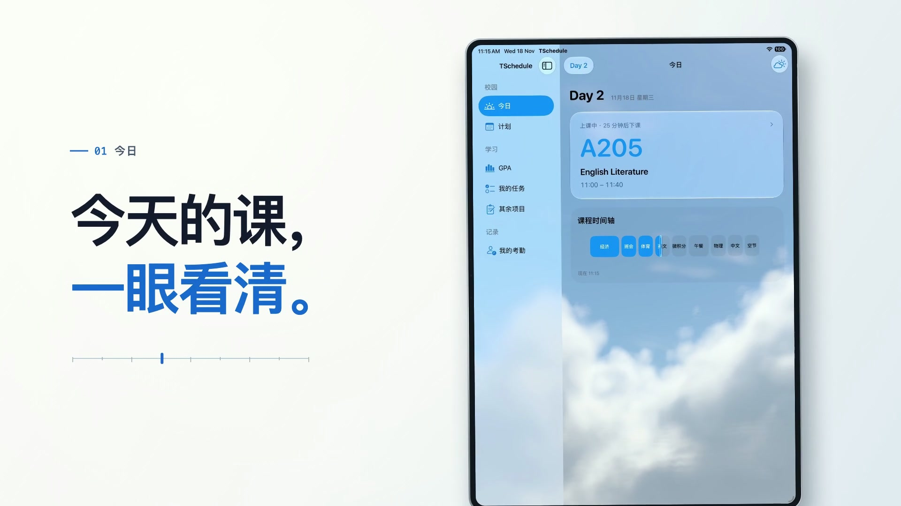

# 澜图：把课表和自己的安排放在一起

老师好！我做了个叫「澜图」的 iPad 小工具，已经在自己的 iPad 上试过了。竖着可以看今天还有什么课，转过来就是一整周，也能把自己的安排放进课表的空档里。

*宣传片里的周计划，画面用的是虚构资料。*

## 它怎么用到校宝

我在 iPad 上打开校宝的官方网页，用自己的账号登录。澜图沿用这次登录，把这个账号本来就能看到的资料整理在 iPad 上；不改动校宝记录，也不把这些资料传到我的服务器。

第一次登录后，澜图把核对过的轮转课表留在这台 iPad，离线也能翻；课表有变动，我可以在设置里更新。作业页会标出上次完整更新的时间。没网时仍能看那次保存的清单，但老师后来改了什么，要等下次连上校宝才知道。作业截止提醒由 iPad 本机安排，换账号不会沿用上一位同学的清单或提醒。

考勤仍从校宝读取；登录有效时也能更新本学期的成绩总览，不会为了看课表反复登录。平常不用让澜图记住密码；只有自己开启「本机代登录」，账号和密码才会保存在这台 iPad 的系统钥匙串里。

如果以后也想把它分享给同学，您觉得有什么是我应该注意的吗？

[看 75 秒宣传片](https://github.com/MTC2009/TSchedule/blob/12bdbc06130c982fc2b80f05e867cfbe780c4088/docs/tschedule-promo/Meet-TSchedule.mp4?raw=1) · [看项目代码](https://github.com/MTC2009/TSchedule)
