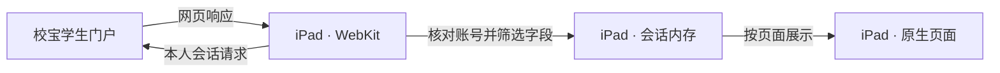

# TSchedule（澜图）技术披露

面向学校 IT Center · 2026-11-21 · iPadOS 版 0.3（构建 3）

## 01｜项目详情与数据边界

**澜图是学生自己在 iPad 上使用的课表和计划工具。** 它把本人校宝账号可查看的资料整理成原生页面，并允许学生在旁边添加个人安排。学校仍保有原始记录，校宝仍决定账号权限；澜图没有全校学生名册、管理员账号或一个代全校登录的服务器。

| 披露项 | 本报告采用的口径 |
| --- | --- |
| 对象 | 今日、计划、任务、GPA、考勤、考试／测评／资料目录、设置，以及可手动打开的校宝网页。应用为独立学生项目，不是学校或校宝发布的软件。 |
| 版本基线 | [公开源码快照 `12bdbc0`](https://github.com/MTC2009/TSchedule/tree/12bdbc06130c982fc2b80f05e867cfbe780c4088)。下文的校务数据流以这一版为准。政策和设置另有本地更新。课表存储及当前学期的前台刷新也已有后续本地实现，单列于第 4 节末，不属于这个公开快照。 |
| 产品形态 | SwiftUI 主 App 与一个锁屏实时活动扩展，面向 iPadOS 26.0 及以上。正常使用真实校宝不需要部署本仓库的 Rust 服务。 |
| 资料出处 | 校务资料来自当前学生门户；个人计划来自学生输入；城市天气另有来源；宣传片、测试账号和测试记录不是学校的数据源。 |

### 图 1 · 一次原生校务阅读经过哪里



**图中的“只读”是指原生校务功能。** 部分列表按校宝网页的约定用 HTTP POST 传查询条件，不能仅凭请求方法判断它在写成绩。登录本身会建立学校会话，个人计划会写入本机；学生在「完整校宝」里主动执行的操作则由网站处理。这里不声称整个浏览器只能读，也不代表校方已批准分发。

阅读顺序：第 2 节找文件；第 3–5 节看登录和各类校务数据；第 6–7 节看保留、锁屏与第三方；第 8–9 节看负载、失败和核验依据。第一次交流也可以只看[给老师的一页介绍](tschedule-it-center-brief.md)。

## 02｜文件结构：每一部分负责什么

公开快照共有 **367 个已跟踪文件**：仓库顶层 8 个、`Xiaobao-iPadOS/` 210 个、`xiaobao-backend/` 30 个、`docs/` 119 个。这里的文件数既包含源码也包含图片、视频和文档，不等于 App 的文件数。完整逐文件名称、字节数与 Git 对象标识见随附清单；第 9 节给出独立生成方法。

| 目录／入口（从仓库根目录起） | 内容及运行边界 |
| --- | --- |
| [Xiaobao-iPadOS/](../Xiaobao-iPadOS/) | `Xiaobao.xcodeproj` 构建主程序和扩展；`Config/` 是两个目标的配置；`Resources/` 有图标等打包资源；`scripts/generate_project.py` 决定目标成员。`Package.swift` 用来测试 Core，并不是 App 入口。 |
| [Sources/Native/](../Xiaobao-iPadOS/Sources/Native/)¹ | `XiaobaoApp.swift` 管前后台和导航；`AppModel.swift` 选择数据源并编排页面；`SchoolPortal.swift` 持有 WebKit。`SchoolPortalSync/` 负责校务读取；`SchoolPortalLogin/` 单独处理自愿绑定。 |
| [Sources/Core/](../Xiaobao-iPadOS/Sources/Core/)¹ | `SchoolPortalData/` 管资料类型、当前账号、缓存及失败；`Planner/` 管本机计划；`CityWeather/` 管独立天气请求。另有 GPA、任务、个性化及天空计算。这里也有历史测试服务客户端，不等于真实校宝走这些接口。 |
| [页面与扩展](../Xiaobao-iPadOS/Sources/)¹ | Native 内的 `Planner/`、`Tasks/`、`GPA/`、`OtherItems/`、`Settings/` 等显示界面，`Atmosphere/` 及其着色器画天空。独立的 `ActivityWidget/` 只渲染主 App 交给系统的锁屏快照。 |
| [Tests/](../Xiaobao-iPadOS/Tests/)¹ | `Core/` 是 Swift 单测；`SchoolPortalSync/` 含 JavaScript、系统 WebKit 和隔离 iPad 测试；`AtmospherePreview/` 是视觉验证工具。不把测试账号作为用户入口。 |
| [xiaobao-backend/](../xiaobao-backend/) | 独立 Rust 测试服务；`src/provider/` 造合成记录，`auth.rs / devices.rs` 管它自己的会话，`work/ / attendance/` 等服务它自己的页面。目录里一份静态高中校历 JSON 还作为资源打进 App；**打包校历不是连接 Rust 服务**，也不拿它补真实校宝的缺项。 |
| [docs/](./) 和[根目录模块索引](../MODULE_INDEX.md) | 使用和设计文档、取景素材、验证图片、支持及送审草案。`REUSABLE_MODULES.md` 记录复用关系，`LICENSE` 说明仓库的软件许可；都不是学习资料的运行时存储。 |

¹ 这几行的短路径均位于 `Xiaobao-iPadOS/` 下。公开快照的 210 个 iPad 项目文件里，144 个在 Sources、43 个在 Tests、12 个在 Resources、其余 11 个是配置、工程、脚本与说明。被忽略的构建产物、归档和开发者电脑其他文件不计入。

## 03｜账号从哪里来，密码什么时候经过 App

**普通登录不需要绑定。** 学生在 App 内打开校宝提供的 HTTPS 登录页，直接向校宝完成登录。WebKit 管理网站 Cookie 等会话数据；原生读取器不从网页密码框提取已有密码，也不把浏览器 Cookie 复制给另一个 HTTP 客户端。

| 时点 | 设备上发生什么 | 能离开该环节的内容 |
| --- | --- | --- |
| 确认本人 | 读取器只在确认的官方主页主框架中运行。网页侧将当前身份字段与本机随机值一起做 SHA-256 摘要。 | 一般身份核对只向原生层返回用于比对的账号标记，不返回整份学生档案。标记不是登录令牌，也不代表校方授权。 |
| 读取一项校务资料 | 使用当前网页会话，先比对账号，读取指定类别、筛选字段，再核对账号。Swift 还检查网页、请求批次和前台状态是否已改变。 | 只有匹配的结果进入该账号的会话内存。切号后晚到的结果不能用来填新页面；会话无法确认时不沿用上一个人的画面。 |
| 主动开启本机代登录 | 只有经过核验的学生才可在设置中绑定。App 单独取得该账号的登录名，学生在本机安全输入框输入密码；不是找回网页曾经输入的密码。 | 一个账号的登录名、密码及绑定标记进入本机钥匙串。不发给项目维护者，不跨设备同步。不能把另一个待登录账号作为绑定目标。 |
| 后续确需登录 | 先尝试已有会话。允许的前台启动恢复，或学生主动打开／刷新 GPA，才可能使用绑定。先把绑定标为暂停，再向识别出的官方表单提交一次；之后独立核对是否仍是同一账号。 | 登录交给校宝处理。拒绝、超时或不能确认结果不反复提交；遇到验证码、额外验证或陌生页面，交回本人。普通翻页、打开网页和后台定时任务不是提交密码的理由。 |

**“自动”不是让 AI 代学生浏览。** 运行时执行的是随 App 打包的固定读取和登录程序；标准客户端未见将网页、成绩或密码发送给云端模型推理的代码。普通手动登录与启用密码绑定是两件事。

**三个容易混淆的开关：** 关闭「打开 App 时恢复登录」只关闭启动触发；「移除已保存的登录」撤销绑定，不退出网页；在 App 里退出校宝或清除本机校宝登录资料，会同时清理绑定和网站数据。结束 App 进程既不是主动注销，也不保证校宝服务器的会话还有效。

代码依据：[原生会话](../Xiaobao-iPadOS/Sources/Native/SchoolPortal.swift) · [主框架读取器](../Xiaobao-iPadOS/Sources/Native/SchoolPortalSync/SchoolPortalReader.swift) · [账号与会话状态](../Xiaobao-iPadOS/Sources/Core/SchoolPortalData/SchoolPortalStore.swift) · [本机钥匙串](../Xiaobao-iPadOS/Sources/Native/SchoolPortalLogin/SchoolPortalLoginVault.swift)。

## 04｜校务数据明细：课表、任务和成绩

**同一项学校资料不是每开一个页面就重新下载。** 页面共享经核验的内存快照。下面列的是允许从网页进入原生模型的主要字段；服务器的网页响应可能含更多字段，不表示 App 会保留或展示整份响应。

| 类别与触发 | 从哪里到哪里／主要字段 | 明确边界 |
| --- | --- | --- |
| 周课表与校历事项：当前周优先；在计划中翻周才读目标周 | 校宝一周的日程 → 课程／活动标识、名称、起止时间、教室、全天标记 → 今日和计划共用。按上海时区，以周日至周六为一周。 | 内存最多留 12 个周快照。不扫整学年。缺轮转日、教室或有效课次时不以样例补齐；个人计划叠加显示而不修改课程。 |
| 学期目录：任务和 GPA 的学期选择器 | 校宝提供的学期标识、名称和当前学期 → 同一个选择状态。切换时保留本次会话已读的学期结果。 | 展开菜单不是读取该目录下所有学期。选择历史学期后才按需取该期任务或成绩，不据本机日期编造可选学期。 |
| 任务：当前页或前台预读 | 在对应学期分页读任务 → 标题、课程、类型、公布及截止时间、提交／批改状态；符合条件时可带已公布单项分数。 | 新学期会话起初只向原生层返回任务元数据；进入该期成绩读取流程后，才允许投影已放出的标准任务分数。未发布任务不展示；未放出及豁免项不显示分数。原生列表不取答案、附件或全文评语。 |
| 成绩总览：进入 GPA、选择该学期或主动刷新 | 校宝课程及其已提供的总分／等级，另有可用的学期 GPA → 原生概览。同一账号、同一学期可复用不足 5 分钟的结果。若已读任务变化，下次打开 GPA 会重读；主动刷新也会重读。 | **任务变了，不等于分数变了。** 它只会让旧的成绩缓存失效，不用任务推算校方成绩。校宝未给 GPA 或读取失败时明确区分，不把试算标成校方成绩。 |
| 单科明细与试算：点进课程或使用本地工具 | 从已读的本人成绩列表选择课程 → 读取该课程的评估分组、已公布项目、可用的权重及分数。试算仅在本机处理输入。 | 不预读所有课程明细；未公布不当作零分；试算不向校宝提交，不进入服务器成绩档案。 |

可核查的字段：[校务模型](../Xiaobao-iPadOS/Sources/Core/SchoolPortalData/SchoolPortalData.swift) · [网页字段筛选](../Xiaobao-iPadOS/Sources/Native/SchoolPortalSync/PortalProjection.js) · [计划的真实数据源](../Xiaobao-iPadOS/Sources/Native/Planner/PlannerSchoolSource.swift) · [校宝 GPA 页面与刷新](../Xiaobao-iPadOS/Sources/Native/SchoolPortalSync/SchoolPortalGradebook.swift)。

**版本后续（本地实现，不属于本报告的公开提交）。** iPad 现已实现[按学年保存的设备课表](../Xiaobao-iPadOS/Sources/Core/SchoolTimetable/README.md)：一次前台导入最多六个教学周，按[主校区高中校历](../xiaobao-backend/src/provider/academic-calendar-hs-2026-2027.json)核对往复出现的课程，临时事项按具体日期保留。课表文件受系统保护、不备份，退出或确认换号即撤销。今日与计划共用，翻周不联网，只有设置中的「更新课表」会替换；旧表不会被一次失败的更新抹掉。已缓存的今日还可使用有效会话更新当前学期任务、考勤及已公布的 GPA 总览，成绩仍不长期落盘。以下各节仍描述页首所列公开版本。

## 05｜校务数据明细：考勤、考试、测评与资料

这些记录沿用第 3 节的同一账号、同一网页会话。原生层选择的是“查看哪一类本人资料”，不是“要查询哪一个学生”。

| 类别 | 触发与给校宝的范围 | 到达 iPad 原生层的内容／不读取的内容 |
| --- | --- | --- |
| 考勤摘要 | 前台可预读默认课堂摘要；切换课堂、日常、活动，或变更日期、状态、页码时，加载相应视图。默认区间由校宝当前学期确定。 | 汇总出勤、迟到、早退、缺勤计数，以及学校实际提供的比率。课堂视图另有分课程计数。不把缺失比率硬算成官方比率。 |
| 考勤明细 | 学生点已列出的课程，或在可分页的记录视图翻页；明细每页 10 条。 | 名称、日期／时间、状态、全天标记及适用时的请假标记。不是请假理由、证明文件、联系方式或全班人员名单。 |
| 考试 | 前台准备当前学期考试列表，按学校给出的日期范围取页。 | 原生列表保留项目标识、标题和有提供时的开始日期；不取试卷、答案或其他人的作答记录。 |
| 测评 | 前台读取当前学生可见的「我的测评」列表。 | 项目标识、名称、已完成／未完成状态（来源未给出时可空）；不取问卷答案，也不代填、提交。 |
| 分享给我的资料 | 前台读取本人的分享目录；目录范围取自本次用户身份响应，并在读取后复核。 | 项目标识、标题、可用的格式。不是下载地址、文件正文、附件批量下载或全校文件盘。 |

**看一条具体路径：** 在考勤页点某门课 → 以已选课程和日期请求一页记录 → 核对返回是否对应课程、页码和账号 → 显示这一页。网络断开显示失败；校宝确认返回空页才显示「无记录」。两者对学生意味着不同的事。

概览预读会先处理目前显示的类别，再准备其余类别。考试和资料的分页有完整性检查；如果学校报告还有数据但返回重复标识、提前空页或超出上限，不把不完整列表伪装成全部结果。

代码依据：[考勤查询与记录校验](../Xiaobao-iPadOS/Sources/Core/SchoolPortalData/SchoolPortalAttendance.swift) · [各类读取与目录裁剪](../Xiaobao-iPadOS/Sources/Native/SchoolPortalSync/PortalRead.js) · [原生考勤页](../Xiaobao-iPadOS/Sources/Native/SchoolPortalSync/SchoolPortalAttendancePage.swift) · [预读顺序](../Xiaobao-iPadOS/Sources/Native/SchoolPortalSync/SchoolPortalWarmup.swift)。

## 06｜数据落在哪里：保留、备份与清理

“在本机处理”不等于“全部只在内存里”，也不等于“一退出就删光”。以下按**实际写入位置**区分。

| 位置 | 包含什么 | 保留、可见性和移除 |
| --- | --- | --- |
| 原生会话内存 | 账号比对标记、已读周、任务／成绩快照、学期目录、考勤和共享目录。 | 转后台会撤下原生记录并清空相应缓存；关闭进程后不会从长期成绩库恢复。手动打开完整校宝时先撤下记录；在同一前台会话中返回，须核对为同一学生，才可能复用 5 分钟内的概览快照。 |
| WebKit 的网站数据 | 官方网站管理的 Cookie、登录状态及其可能留下的本地网站数据。预设为持久网站存储。 | 可能跨进程继续使用，是否有效由网站决定。App 的退出／清理操作清除本 App 使用的网站数据并重建 WebView；不等于清空 Safari，不保证撤销其他设备会话，也不删除学校原始记录。 |
| iPad 系统钥匙串（选用） | 绑定账号标记、注册标识、暂停／恢复选项，以及用户同意保存的登录名和密码。 | 需要设备已设锁屏密码、解锁可读，条目不可同步或迁移到新设备。不降级成普通文件。移除绑定或 App 内主动退出会撤销；若暂不能删除，先取消本地使用资格，解锁后再清理。 |
| App 的偏好存储 | 外观、昵称、提醒文字、天气选择与样本等；另有生成账号标记的本机随机值、绑定登记／待清理标志。 | 不把学校密码或原生成绩放进偏好。可在相应设置更改或清空个人文案；退出学校不会重置整台设备的偏好。不把这些偏好的备份行为与钥匙串或计划文件混为一谈。 |
| App 沙盒的个人计划文件 | `Application Support/XiaobaoPlanner-v1/plans.plist`：同一文件按归属分区保存个人标题、日期、时段、完成状态、提醒、常用和每周安排。不是把学校课表复制到本地。 | iPad 写入采用原子替换和系统完整文件保护，目录显式标记不参加系统备份。退出、终止 App 不会顺带删计划。可回到对应账号的计划中删除；撤销／重做历史只在会话内。 |
| iPadOS 系统展示 | 已安排的个人计划通知及用户手动启动的当前课时活动。 | 这是系统持有的展示副本，不是学业数据库。锁屏可能让旁人看见文字；可结束实时活动、取消提醒或调整系统显示。不能用“App 已退到后台”推断锁屏内容已经消失。 |

代码依据：[网页清理](../Xiaobao-iPadOS/Sources/Native/SchoolPortal.swift) · [会话失效与缓存](../Xiaobao-iPadOS/Sources/Core/SchoolPortalData/SchoolPortalStore.swift) · [计划落盘保护](../Xiaobao-iPadOS/Sources/Core/Planner/PlanStore.swift) · [钥匙串实现](../Xiaobao-iPadOS/Sources/Native/SchoolPortalLogin/SchoolPortalLoginVault.swift)。[Apple 对该钥匙串保护级别的说明](https://developer.apple.com/documentation/security/ksecattraccessiblewhenpasscodesetthisdeviceonly)。

## 07｜谁还能看到什么：网络、系统和支持

| 接收方／路径 | 触发、数据方向与用途 | 不应误解为 |
| --- | --- | --- |
| 学校学生门户 `tsinglanstudent.schoolis.cn` | 官方网页接收登录；已登录读取携带该网站自己的会话，服务器按操作收到学期、日期、页码或所选课程等范围，也能看到正常网络连接信息。学校返回本人获准的记录。 | 不是开发者接收密码或成绩。学校／服务商自己的服务日志、保存期限和网页内依赖不在本项目控制内。 |
| Open-Meteo · `api.open-meteo.com` | 默认跟随东莞市天气。iPad 独立发送配置中写定的城市坐标，取当前天气代码和有效时间；服务方能收到 IP 和请求参数。可关闭跟随、改为手动天空。 | 不申请设备定位，不发送学校账号、课表或成绩。此 HTTP 客户端不带 Cookie、凭据存储或 URL 缓存，不跟随重定向。[天气服务隐私说明](https://open-meteo.com/en/terms)独立适用。 |
| iPadOS 通知中心 | 学生为个人计划设提醒时可请求通知权限；主 App 交给系统的是计划标题、提醒时间／提前量、可选副标题等。系统负责到点显示。 | 不是 APNs 群发，也不要求学校处有推送服务器。正常构建不排入样例课前提醒；升级会清理该类遗留通知。 |
| ActivityKit → WidgetKit | 学生明确启动锁屏课表后，主 App 从已加载的当天课表生成快照：起止时间、可选的下一节名称和显示样式；系统扩展在锁屏绘制。 | 不传学生标识、成绩或教室给扩展；扩展不独立登录学校。未注册此活动的远程推送。课时结束或来源失效会尝试结束；最终显示时机由系统控制。 |
| 维护者邮箱／GitHub | 主动发邮件，邮件服务和维护者才收到来信及发送方地址；主动打开代码库、网页或提交公开反馈时，则发生与相应平台的交互。 | 正常校务阅读不通过邮箱或 GitHub。源码中未发现广告、跨 App 跟踪或把真实校务响应自动上传给开发者的 SDK。此结论不涵盖网站自己的脚本、系统诊断或使用者手动分享。 |

**网页与原生的范围不同。** 原生读取只接受固定官方来源和主页主框架；可见的手动浏览器能打开 HTTPS 网页，也可能加载网站指定的资源。因此上表是应用已知的数据接收路径，**不是对整台 iPad 所有可能域名的白名单**。平台使用默认服务器信任验证，不把这一点描述成独立的证书审计。

代码依据：[天气传输](../Xiaobao-iPadOS/Sources/Core/CityWeather/OpenMeteoClient.swift) · [本机通知](../Xiaobao-iPadOS/Sources/Native/ReminderService.swift) · [实时活动控制](../Xiaobao-iPadOS/Sources/Native/LessonActivity/LessonActivityController.swift) · [扩展收到的字段](../Xiaobao-iPadOS/Sources/ActivityWidget/LessonActivityAttributes.swift)。

## 08｜请求何时发生，失败时会怎样

下面是**一个设备的代码行为**，不是给学校建议的配额，也不是全校实测吞吐量。一次界面读取可能包含身份复核、学期目录和若干分页；“一次点按”不等于“一次 HTTP 请求”。

| 条件 | 当前实现 | 对结果的含义 |
| --- | --- | --- |
| 登录后／切换页面 | 优先当前页，其余周课表、任务、考勤摘要、考试、测评、分享目录在前台依次准备；按账号、学期或周复用已读结果，防止相同请求重复在途。 | 不是每到一个页面才首次开网页，也不是一次下载所有明细。显式页面操作可与预读交错；串行预读不等于整台设备始终只有一个连接。 |
| 学校身份复核 | App 活跃、有已核对账号、未打开完整校宝时，约每 30 秒检查一次。每个读数操作还会在读取前后核对身份。 | 不是每 30 秒重登或抓全量资料。退后台取消校务读数并使旧结果失效；系统锁屏快照另见第 7 节。 |
| 分页与等待界限 | 任务、考试、分享目录每次分页请求 50 项、最多 64 页；考勤明细每页 10 条。身份读取另有原生约 8 秒保护，普通网页导航约 10 秒，代登录结果等待约 16 秒。 | 是客户端的有界操作，不是学校服务响应承诺；各环节不同，不能相加当作固定等待时间。超时或拒绝不触发循环提交密码。 |
| 断网／拒绝／格式变化 | 无法核实身份时隐藏旧账号记录。单类资料被拒绝、缺项或格式不合规，显示该项不可用并允许适当重试；明确过期与普通网络故障分别处理。 | 正常构建没有切换到样例资料的回退路径；失败不代表零分、零缺勤或无人发布任务。 |
| 天气刷新 | 自动天气只在前台启用：正常间隔约 30 分钟，失败后约 10 分钟再试；2 小时内与 24 小时内的样本有不同显示口径。 | “24 小时”是样本是否仍可用于展示的上限，不是对存储介质物理擦除的承诺。与学校身份的 30 秒复核无关。 |

**运行条件与局限。** 真实路径依赖校宝现行学生网页及返回格式，不是有稳定版本合同的机构接口；学校改版、登录过期或网络中断都可能影响部分页面。客户端没有跨设备统一限流、已安装副本的远程停用开关或校方负载看板。工程配置声明了本地联网和后台 fetch；但真实校宝不走本地 Rust，也不会因此在后台用学校密码轮询。标准 Debug 与 Release 都没有启用内部样例入口。

代码依据：[生命周期与复核节奏](../Xiaobao-iPadOS/Sources/Native/XiaobaoApp.swift) · [数据源与后台分支](../Xiaobao-iPadOS/Sources/Native/AppModel.swift) · [读取范围与分页](../Xiaobao-iPadOS/Sources/Native/SchoolPortalSync/PortalRead.js) · [天气节奏](../Xiaobao-iPadOS/Sources/Core/CityWeather/CityWeatherStore.swift) · [系统配置](../Xiaobao-iPadOS/Config/Info.plist)。

## 09｜构建、来源和验证记录

**可复核的起点。** [公开仓库快照](https://github.com/MTC2009/TSchedule/tree/12bdbc06130c982fc2b80f05e867cfbe780c4088)完整提交号为 `12bdbc06130c982fc2b80f05e867cfbe780c4088`。iPad 的 Xcode 工程由仓库脚本生成，使用系统 SwiftUI、WebKit、Security、UserNotifications、ActivityKit、WidgetKit、Metal 等框架；标准主程序没有单列第三方 Swift 包。Rust 服务独立使用 Axum、Tokio 和 SQLite，依赖由 Cargo.lock 固定；它不是发给每个学生的云端服务。

**开发用数据与软件来源。** 另一条链路是合成资料提供器 → Rust JSON 服务 → 测试客户端 `CampusConnection` → 专用缓存。SQLite 保存该测试服务的设备续期记录，不是校宝用户或成绩数据库。模拟器取景和网页替身用虚构记录；参考学生网页的展示规则不等于调用获授的机构 API。仓库的软件许可不授予学校内容或服务的使用权。

| 证据及日期（2026-11-21） | 核验结果和不能据此证明的事 |
| --- | --- |
| 本次重新运行的本地测试 | Swift 207 项、JavaScript 27 项、Rust 36 项通过。Swift 与 Rust 的集成用本机临时数据库和合成服务；没有连接学校测试。 |
| 本次系统 WebKit 往返 | 本机回环测试通过；校务日程、任务、考勤、GPA 及同账号恢复均由合成页面提供。测试服务观察到预期的读取，**这条恢复测试没有提交密码**。不等于所有真实学生都能自动登录。 |
| 本地 iPad Release | 未签名设备构建通过：0.3（3）、最低 26.0、仅 iPad。主包标识为 `cn.xiaobao.ipados.prototype`，内嵌一个 `LessonActivityWidget` 扩展，并有本地双语政策资源。初次检查没有清单；其后同日补入 [Required Reason API 清单](tschedule-app-store/05-build/app-privacy.md#required-reason-api)，另跑未签名 Release 归档确认主包内的文件与源一致。仍未制作正式签名归档。 |
| 其他已有证据／未验证 | 一名实际使用者报告本人账号的登录恢复已在自己的 iPad 上正常工作；此前隔离 iPad 测试覆盖重复提交、账号变化、拒绝及离线条款入口。没有多人容量测试、学校服务器日志、供应商审计或覆盖所有 iPadOS 版本的结果。 |

要独立列出第 2 节的全部文件，可在完整仓库运行以下**只读**命令。清单只列版本库元数据，不遍历任何人的设备或登录资料。

```sh
git -c core.quotepath=false ls-tree -r -l --full-tree 12bdbc0
```

复核入口：[iPad 工程生成规则](../Xiaobao-iPadOS/scripts/generate_project.py) · [Swift 测试](../Xiaobao-iPadOS/Tests/Core/) · [校宝隔离测试说明](../Xiaobao-iPadOS/Tests/SchoolPortalSync/README.md) · [Rust 依赖](../xiaobao-backend/Cargo.toml)与[接口说明](../xiaobao-backend/API.md) · [送审材料说明](tschedule-app-store/05-build/README.md)。

本报告描述所列版本，不代替学校政策、分发许可或独立安全审计。如有实现与本文不一致的地方，可告知版本与现象：[联系维护者](mailto:steven.xie.28.tsinglan.org@gmail.com)。不需要提供学校密码、验证码、Cookie 或能识别学生的截图。

### 2026-11-22 — 本地后续版本：作业清单与系统提醒（非上文公开快照）
Model: Codex · Keywords: assignment-snapshot / offline-notifications。当前本地实现新增[本机作业模块](../Xiaobao-iPadOS/Sources/Core/SchoolAssignments/README.md)：按当前学生和实际已读学期保存不含成绩的完整清单，使用受保护、不备份文件；离线可看上次确认时间，网页核对账号期间隐藏。校宝明确拒绝、退出或换号会清除。经选择可在截止前一小时本地提醒，锁屏标题须另启。任务没有已验证的增量接口，仍以前台的完整分页核对更新和撤回，不增加学校写入、后台读取或开发者服务器。
